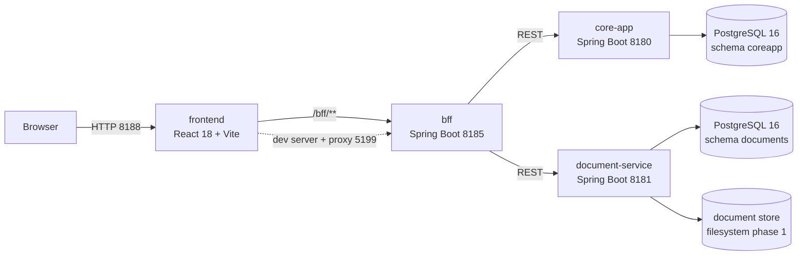

# Claims Platform — enterprise insurance claim management

Monorepo of the enterprise application for managing insurance claims (practical file handling):
three Spring Boot 3.3 / Java 21 services, one React 18 + TypeScript frontend, one PostgreSQL
database and a fully automated CI/CD pipeline.

[](https://github.com/France012/test_newera/actions/workflows/ci.yml)
[](https://github.com/France012/test_newera/actions/workflows/codeql.yml)
[](https://github.com/France012/test_newera/releases)
[](#license)

## Logical view



No Maven dependency exists between the three services: they only talk over HTTP, so each one can be
built, versioned, containerised and scaled on its own.

## Modules

| Module             | Responsibility                                                                      | Language / stack                 |
| ------------------ | ----------------------------------------------------------------------------------- | -------------------------------- |
| `core-app`         | Claim lifecycle (state machine), policies, claim ⇄ document linking                 | Java 21, Spring Boot 3.3.5       |
| `document-service` | Binary document upload/download, metadata, soft delete, pluggable storage port      | Java 21, Spring Boot 3.3.5       |
| `bff`              | Backend for frontend: aggregation and shaping for the UI, CORS, downstream timeouts | Java 21, Spring Boot 3.3.5       |
| `frontend`         | Claim list, claim detail and dashboard UI                                           | React 18, TypeScript 5.5, Vite 5 |
| `infra`            | Dockerfiles, local orchestration, Kubernetes base, helper scripts                   | Docker, Compose, Kustomize       |

## Ports

| Service            | Port | Notes                                                   |
| ------------------ | ---- | ------------------------------------------------------- |
| `frontend` (nginx) | 8188 | container only, unprivileged nginx (uid 101)            |
| `frontend` (dev)   | 5199 | `npm run dev`, proxies `/bff` to 8185                   |
| `frontend` (prev)  | 5198 | `npm run preview`                                       |
| `bff`              | 8185 | exposes `/bff/v1/**`                                    |
| `core-app`         | 8180 | exposes `/api/v1/**`, `/actuator/health`, `/swagger-ui` |
| `document-service` | 8181 | exposes `/api/v1/documents`, `/actuator/health`         |
| `postgres`         | 5442 | host port of the `postgres:16-alpine` container         |

## Quickstart

### Backend (Java 21, Maven wrapper included)

```bash
./mvnw -B verify                      # compile + test + spotless + checkstyle on all 3 modules
./mvnw -B -pl core-app -am package    # single module
java -jar core-app/target/*.jar       # needs POSTGRES_USER / POSTGRES_PASSWORD / CORE_APP_DB_URL
```

### Frontend (Node 20)

```bash
npm --prefix frontend ci
npm --prefix frontend run dev         # http://localhost:5199
```

### Full stack

```bash
cp .env.example .env   # then replace every __change_me__
docker compose -f infra/docker-compose.yml up --build
# UI on http://localhost:8188, API through the BFF on http://localhost:8185/bff/v1
```

## Command reference

| Task                 | Backend                                           | Frontend                                 |
| -------------------- | ------------------------------------------------- | ---------------------------------------- |
| Build                | `./mvnw -B -DskipTests package`                   | `npm --prefix frontend run build`        |
| Unit tests           | `./mvnw -B test`                                  | `npm --prefix frontend run test:run`     |
| Full verification    | `./mvnw -B verify`                                | `npm --prefix frontend run typecheck`    |
| Lint                 | `./mvnw -B checkstyle:check`                      | `npm --prefix frontend run lint`         |
| Format check         | `./mvnw -B spotless:check`                        | `npm --prefix frontend run format:check` |
| Format apply         | `./mvnw -B spotless:apply`                        | `npm --prefix frontend run format`       |
| Docs/YAML formatting | `./frontend/node_modules/.bin/prettier --check .` | —                                        |

## Documentation

- API contracts (reviewed OpenAPI snapshots): [`docs/api/`](docs/api)
- Database contract, Flyway rules and migration guard: [`docs/db/README.md`](docs/db/README.md)
- CI/CD map, required secrets, local reproduction: [`docs/ci.md`](docs/ci.md)
- Versioning and release process: [`docs/versioning.md`](docs/versioning.md)
- Architecture, containers and ADRs: [`docs/architecture/README.md`](docs/architecture/README.md)
- Infrastructure and container images: [`infra/README.md`](infra/README.md)
- Contribution rules: [`CONTRIBUTING.md`](CONTRIBUTING.md) · Security policy: [`SECURITY.md`](SECURITY.md)

## Security

- No secret is stored in the repository; secrets come from the environment, CI secrets or OIDC.
- Container images are signed with `cosign` in keyless mode and published with a CycloneDX SBOM.
- Every push to `main` runs unit tests, lint, SCA (Trivy + `npm audit`), SAST (CodeQL) and secret
  scanning (gitleaks + `grep` gate).

## License

UNLICENSED — proprietary software, internal enterprise use only.
