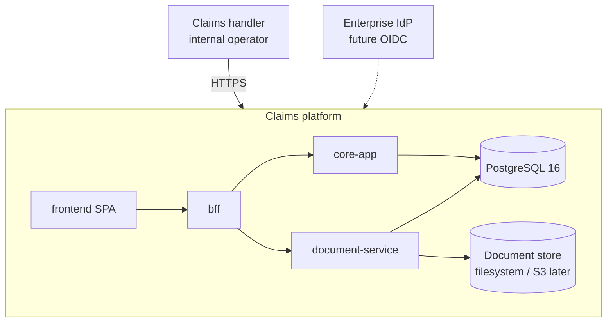
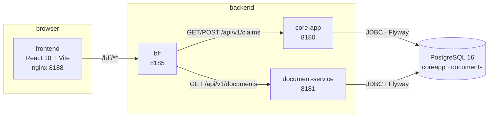

# Architecture

## System context (C4 level 1)

## Containers (C4 level 2)

## Module responsibilities

| Module             | Responsibility                                                                   | Owns                                                   |
| ------------------ | -------------------------------------------------------------------------------- | ------------------------------------------------------ |
| `core-app`         | Claim lifecycle (7-state machine), policies, claim ⇄ document association        | schema `coreapp`, `/api/v1/claims`, `/api/v1/policies` |
| `document-service` | Document binaries, metadata, soft delete, storage port (filesystem now, S3 next) | schema `documents`, `/api/v1/documents`                |
| `bff`              | Aggregation and shaping for the UI, CORS, downstream timeout policy              | no database, `/bff/v1/**`                              |
| `frontend`         | Operator UI: claim list, claim detail, dashboard                                 | no server state, `/bff/v1/**` consumer                 |
| `infra`            | Dockerfiles, compose, Kustomize base, helper scripts                             | build/release mechanics                                |

## Dependency rules

- **No Maven dependency between the three services.** They are separate deployables that share only
  the root aggregator POM (build conventions). Communication is HTTP only, so each service can be
  built, versioned and scaled independently.
- The frontend depends on **one** backend surface: the BFF. It never talks to `core-app` or
  `document-service` directly, so internal API changes do not leak into the UI.
- Persistence is schema-per-service inside one PostgreSQL instance in dev (two instances in
  production). Each service owns its Flyway history; no cross-schema foreign keys. `claimId` in
  `documents` is a logical reference only.
- Hibernate never creates the schema: `ddl-auto: validate` everywhere, Flyway owns the DDL
  (`docs/db/README.md`).

## Runtime cross-cutting concerns

| Concern            | Decision                                                                                |
| ------------------ | --------------------------------------------------------------------------------------- |
| Error contract     | RFC 9457 `application/problem+json`, no stack trace or internal message in responses    |
| Health             | `/actuator/health` (with probes enabled) on every service; `/healthz` on the nginx tier |
| Security headers   | Set by nginx (CSP `default-src 'self'`, `X-Frame-Options: DENY`, `nosniff`)             |
| CORS               | BFF only, explicit origin list, never `*` (credentials enabled)                         |
| Persistence mode   | Stateless services; document binaries on a volume/PVC behind `DocumentStoragePort`      |
| Container security | non-root uid, read-only root filesystem, all capabilities dropped, `restricted` PSA     |

## Decisions

See [`adr/`](adr) — one file per decision, immutable once accepted; a superseding decision is a new
ADR that references the old one.

| ADR  | Title                                             |
| ---- | ------------------------------------------------- |
| 0001 | Monorepo with a Maven multi-module aggregator     |
| 0002 | Hexagonal architecture per service                |
| 0003 | Security baseline: keyless signing and scanning   |
| 0004 | Versioning: manual `VERSION` + semantic-release   |
| 0005 | Contracts-first OpenAPI snapshots                 |
| 0006 | SCA: Trivy first, OWASP Dependency-Check weekly   |
| 0007 | Unprivileged nginx runtime and `wget` healthcheck |
| 0008 | Single Prettier installation                      |
| 0009 | OpenAPI snapshots with a YAML parsing gate        |
| 0010 | Two-level secret scanning, no mandatory secret    |
| 0011 | Image naming and tagging for GHCR                 |
| 0012 | SpotBugs and Checkstyle suppressions deferred     |
